# CRM-Fachkonzept: Coffee-Bike-Caterer im Franchise-Netz

[Fachkonzept als PDF lesen (zwei Seiten)](crm-fachkonzept.pdf)

## Worum es geht

Übungskonzept für eine CRM- und CX-Lösung mit der BSI Customer Suite. Grundlage ist ein echtes Kundenprojekt, anonymisiert. Es ist ein Konzept, kein laufendes BSI-System, und alle Zahlen sind Annahmen.

## Inhalt

1. `content/`: der vollständige Konzepttext (`konzept.md`).
2. `diagrams/`: Mermaid-Quellen, SVGs und das Render-Skript.
3. `demo/`: eine kleine REST-API, die aus einer Formularanfrage einen Lead macht.
4. `pdf/`: Vorlage, Schriften und Build-Skript für das zweiseitige PDF. Das fertige PDF liegt als `crm-fachkonzept.pdf` im Hauptordner.

## Kurzfassung

Ein Coffee-Bike-Caterer in Bonn beantwortet jede Anfrage am selben Tag. Zentral erfasst werden aber nur Formularanfragen, deshalb hängen Nachfassen und Wiederbuchung vom Gedächtnis ab. Die zwei Ziele: jede Anfrage über alle vier Kanäle erfassen und mehr Kunden zur Wiederbuchung bringen. Die Systemauswahl vergleicht HubSpot, Salesforce, Microsoft Dynamics 365 und BSI. Für einen Einzelbetrieb wäre BSI zu groß. Für ein Franchise-Netz mit vielen Standorten passt es.



Prozess: Die Anfrage wird zum Lead, mit Dublettenprüfung und Nachfass-Aufgabe nach drei Tagen.



Integration: Vier Kanäle laufen in BSI CRM, jeder Standort sieht seine Daten, die Zentrale alle KPIs.

## Demo starten

```bash
./demo/demo.sh
```

Das Skript legt beim ersten Start eine virtuelle Python-Umgebung in `demo/.venv` an, startet die API auf Port 8000 und schickt Beispielanfragen. Die Ausgabe zeigt:

1. Eine gültige Formularanfrage wird zum Lead mit Status `neu` (HTTP 201).
2. Dieselbe E-Mail-Adresse fragt noch einmal an. Die Dublettenprüfung gibt den bestehenden Lead zurück (HTTP 200).
3. Eine Anfrage ohne Einwilligung wird abgelehnt: `Einwilligung fehlt` (HTTP 400).
4. Die Liste aller Leads.
5. Der Lead wechselt auf den Status `gebucht`.

Danach stoppt das Skript den Server wieder.

## Neu bauen

```bash
./diagrams/render.sh   # SVGs aus den Mermaid-Quellen rendern und Labels prüfen
./pdf/build.sh         # crm-fachkonzept.pdf mit Headless Chrome bauen
```

Voraussetzungen: Node, Google Chrome, Mermaid CLI (`PUPPETEER_SKIP_DOWNLOAD=1 npm install -g @mermaid-js/mermaid-cli`) und Python 3 für die Demo.

## Hinweis

`content/konzept.md` ist die vollständige Fassung. Das PDF ist die verdichtete Fassung zum Präsentieren. Dort erscheinen die Prozessschritte als Diagramm statt als Liste. Die Schriften in `pdf/fonts` stehen unter der SIL Open Font License (`pdf/fonts/OFL.txt`).
